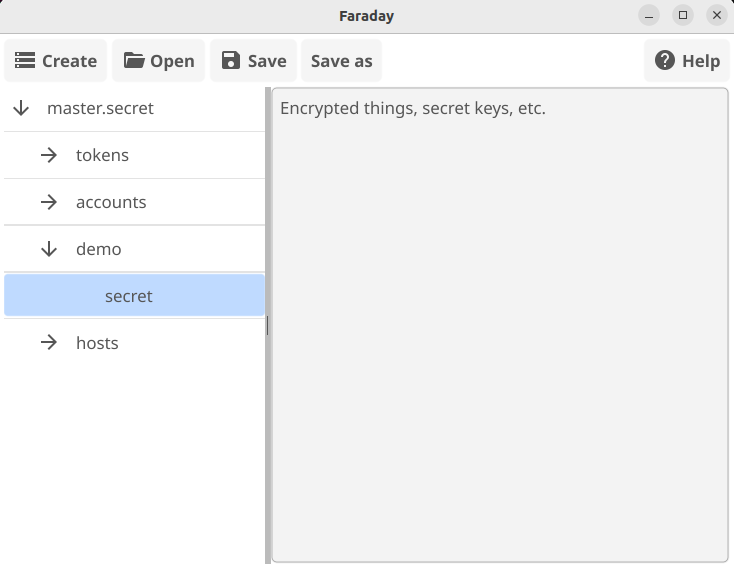

# Faraday

A lightweight encrypted notebook for API keys, configuration files, and private notes, with a desktop UI and command-line access.

Faraday stores all entries in a single password-encrypted file. Organize text by `namespace/name`, edit it in the UI, and retrieve individual entries from shell scripts when needed.

## Why Faraday?

Secrets tend to accumulate in `.env` files, configuration folders, and random notes. Faraday brings them into one encrypted vault protected by a master password, reducing the secrets available to software that searches your disk for credentials.

Store a complete `.env`, JSON configuration, an individual API key, or a note as an entry. Faraday treats the content as plain text and does not interpret its format.

You can also create a separate vault containing only the keys needed for a particular task and share that encrypted file. Communicate its password separately.

## Build from source

Build the desktop and command-line binary from the repository root:

```bash
cd src
go build -o faraday main.go
```

To build the Linux D-Bus daemon, run this from the same `src` directory:

```bash
go build -o faradayd dbus_linux.go
```

## Desktop UI

Create or open a vault, browse namespaces and entries in the tree, and edit their content in the text editor. Use the toolbar to save, save as a separate vault, or save with a new password.



## Command-line usage

Every command prompts for the vault password. Place all flags before the command.

Entry paths consist of exactly two non-empty parts separated by `/`: `namespace/name`.

### Create a vault

```bash
faraday --vault path_to_vault create
```

Creates an empty vault. An existing file is not overwritten.

### Read an entry

```bash
faraday --vault path_to_vault --field fieldNS/fieldName read
```

Writes the entry content to standard output. For example, restore a configuration file:

```bash
faraday --vault secrets.vault --field myapp/devKeys read > .env
```

The resulting file contains plaintext and remains on disk until you remove it.

### Create or update an entry

Pass content as an argument:

```bash
faraday --vault path_to_vault --field fieldNS/fieldName --content "some_value" update
```

Or omit `--content` to read the content from standard input:

```bash
faraday --vault secrets.vault --field myapp/devKeys update < .env
```

Pipes work too:

```bash
printf '%s' 'some_value' | faraday --vault secrets.vault --field myapp/apiKey update
```

Standard input is used for entry content; the password is requested through the terminal. For sensitive values, prefer stdin: literal command arguments can be recorded in shell history and exposed in process arguments.

### Run an application with a temporary .env

The following Bash script reads an entry into .env, runs the application, and removes the file when the application exits:

```bash
#!/usr/bin/env bash
set -euo pipefail

# Run from the application's directory.
umask 077

# Refuse to overwrite an existing .env.
set -o noclobber
exec 3> .env

# Clean up on exit, including command failures.
trap 'rm -f -- .env' EXIT
trap 'exit 130' INT
trap 'exit 143' TERM

faraday \
    --vault /path/to/secrets.vault \
    --field myapp/devKeys \
    read >&3

exec 3>&-

# Keep the application in the foreground.
npm run dev
```

Faraday prompts for the master password through the terminal. The application starts only if the entry is retrieved successfully.
The .env file contains plaintext while the application runs. Cleanup cannot be guaranteed after SIGKILL, a system crash, or power loss. If a file remains, the next run refuses to overwrite it.

## D-Bus daemon (Linux)

Use `faradayd` to give local scripts and applications access to selected vault entries over the user D-Bus session. The daemon prompts for the master password once at startup.

### Prepare the vault and config

1. Run `./faraday` from `src` to open the desktop UI.
2. Create a vault, add the entries you want to use, and save the vault with a master password.
3. Create a JSON config with the vault path and the exact entry paths the daemon may return. An example config is also available in `src`.

```json
{
    "vault_path": "path_to_vault",
    "allowed_keys": [
        "tokens/gh",
        "some_other/secret"
    ]
}
```

### Start the daemon

```bash
./faradayd --config path_to_config
```

Enter the vault password when prompted. After startup, the daemon retains only the allowlisted entries for lookup. The full decrypted vault and the master password are used during startup and are not retained by the service. Stop the daemon with `Ctrl+C`.

### Read an entry over D-Bus

The service and interface are both named `io.github.Tripod311.Faraday`. The object path is `/io/github/Tripod311/Faraday`. The `ReadKey` method takes a string in `namespace/name` form and returns the entry content as a string.

From another terminal in the same user session, run:

```bash
busctl --user call \
    io.github.Tripod311.Faraday \
    /io/github/Tripod311/Faraday \
    io.github.Tripod311.Faraday \
    ReadKey s 'tokens/gh'
```

The command prints the plaintext entry to the terminal. The daemon serves only the keys listed in `allowed_keys`. Any application that can call the service on your user D-Bus session can request those keys while the daemon is running.

## Encryption

- Argon2id derives a 256-bit key from the master password using a random 16-byte salt, 64 MiB of memory, 3 passes, and parallelism of 4.
- AES-256-GCM encrypts the vault contents and authenticates the encrypted data and format header.
- Each save generates a new salt and nonce.
- Entry names, namespaces, and content are encrypted together. Only format metadata, cryptographic parameters, and ciphertext remain visible.
- The master password is not stored in the vault. There is no password recovery mechanism.

Use a strong, unique master password. Anyone with a copy of the vault can attempt to guess it offline.

## Security scope

Faraday protects secrets stored in a closed vault from being read as ordinary files. It does not isolate untrusted applications: software that receives a secret can read it, and a compromised device may capture passwords or decrypted data while the vault is open.

Keep backups of the encrypted file. Changing the password of the current vault does not change the password protecting older copies.

## Built with

Go and [Fyne](https://fyne.io/).